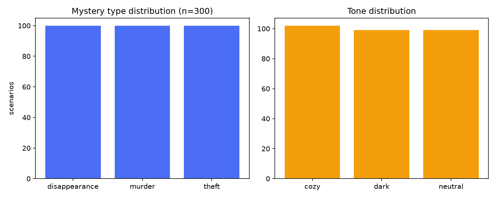
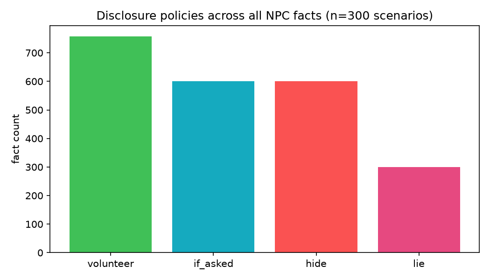
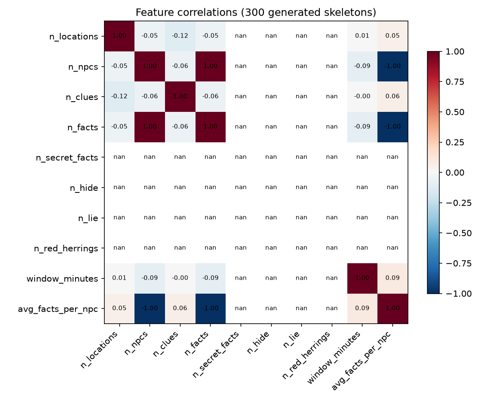

# Deliverable 1 — Phase 2: Data Foundations Evidence

> **Purpose:** this document is the human-readable evidence pack for Phase 2 of Deliverable 1.
> It summarises what data exists, how it was produced and cleaned, what features were derived,
> what the EDA shows, and where every artifact and script lives. Machine-readable evidence
> (run logs, hashes, reports) is committed alongside the code; this file ties it together.

**Route (HG-17, decided):** the dataset is **100% synthetic, generated by our own code** —
no scraping, no downloaded third-party datasets. "Collection evidence" is therefore the
generator source code plus the run manifests/logs recorded during execution (including
timing, environment, dataset hash, and validation results).

---

## 1. Dataset at a glance

| Property | Value |
|---|---|
| Scenarios | **300** (skeleton mystery bundles) |
| Balance | 100 theft · 100 disappearance · 100 murder; tones 102/99/99; difficulties 102/99/99 |
| Format | JSONL — one validated bundle per line (world + truth + clues + all NPC files) |
| Validation | **0 rejected**: every row re-validated against Pydantic schemas **and** `validate_bundle()` semantic checks |
| Duplicates | **0** (SHA-256 over canonical JSON) |
| Content bounds | 3–4 locations, 5–6 NPCs, 4–6 clues per scenario; timeline minutes 0–10 |
| Integrity hash | `f52b2e1a…5827a` (full SHA-256 in `data/reports/dataset_manifest.json`) |
| Raw data on disk | `data/raw/skeletons.jsonl` — **gitignored by design** (repo rule: no big raw datasets) |

The 300 scenarios are the **seed corpus** for the fine-tuning chain: skeleton → teacher LLM
expansion (HG-11, local/Kaggle, no API keys) → ~1,500–2,400 validated stage examples → QLoRA SFT.

## 2. How the data was collected (evidence: code + run logs)

**Generator:** `src/fabula/training_data/` — a deterministic symbolic generator (WS-B).

- `skeletons/theft.py`, `disappearance.py`, `murder.py` — per-mystery-type content pools
  (targets, methods, motives, title/intro formats) kept teen-rated and non-graphic (HG-13).
- `skeletons/common.py` — shared pools (towns, names, roles, traits, location profiles,
  witness/alibi/rumour/trace lines).
- `skeletons/generate.py` — `generate_skeleton(type, seed, tone, difficulty)` builds a full
  bundle: locations + connections, NPC roster + minute-level schedules, facts with
  disclosure policies, exactly one culprit (with cover story + lie facts), one witness,
  one red-herring NPC, 4–6 clues wired into the fact graph, and 4+4 accusation options.
- `build_skeleton_dataset.py` — balanced export with per-row provenance tags
  (`generator`, `generator_version`, `schema_version`, `validated: true`).

**Determinism:** the same `(type, seed, tone, difficulty)` always produces a byte-identical
bundle (`random.Random(f"fabula-skeletons-v1:{type}:{seed}")`); proven in
`tests/test_skeletons.py` (`test_same_seed_is_identical`). This makes the dataset fully
reproducible from the code alone.

**Spoiler firewall at the data level (enforced by test, not by wording):**
`test_only_culprit_holds_true_account` checks across all types and seeds that **only the
culprit** has a `cover_story` and facts with `disclosure = lie`; every other NPC has none.

**Run evidence (committed):**

| File | Content |
|---|---|
| `data/reports/collection_log.json` | command, timestamp, duration (0.5 s), Python 3.11.9, generator version, counts per type/tone/difficulty, dataset SHA-256 |
| `data/reports/dataset_manifest.json` | full manifest incl. rejected-row list (empty) and hash |

## 3. How the data was cleaned (evidence: script + report)

**Script:** `data/scripts/clean.py` — re-reads the raw JSONL and, per row:

1. re-validates against the Pydantic schema (catches any drift),
2. re-runs `validate_bundle()` (8 semantic issue codes: disconnected graph, schedule/timeline
   conflicts, bad time window, culprit missing account, lie without cover story, clue implies
   unknown fact, no culprit evidence),
3. drops exact duplicates by canonical SHA-256.

**Result (committed evidence: `data/reports/cleaning_report.json`):**

| Metric | Value |
|---|---|
| Rows in | 300 |
| Invalid removed | 0 |
| Duplicates removed | 0 |
| Rows out | **300** |
| Missing values | impossible by construction (`extra="forbid"`, every field required) |
| Outliers | bounded by schema (locations 3–4, NPCs 5–6, clues 4–6, minutes 0–10) |

## 4. Feature strategy

**Scripts:** `data/scripts/features.py` (encoding + scaling), outputs in `data/processed/`
(gitignored; regenerate in seconds — see §6).

16 numeric structural features (min–max scaled to [0, 1] in `features_scaled.csv`):

| Feature | Mean over 300 scenarios | Meaning |
|---|---|---|
| `n_locations` | 3.50 | map size (3–4) |
| `n_npcs` | 5.53 | cast size (5–6) |
| `n_clues` | 5.04 | clue count (4–6) |
| `n_facts` | 7.53 | total NPC memory facts (varies 7–8: 4–6 gossip NPCs) |
| `n_secret_facts` | 3.00 | facts marked secret — **invariant: exactly 3** (culprit crime + culprit trace + herring secret) |
| `n_volunteer` | 2.53 | volunteer facts (varies 2–3) |
| `n_if_asked` / `n_hide` / `n_lie` | 2.00 / 2.00 / 1.00 | **invariant** — if-asked=2, hide=2, lie=1 per scenario |
| `n_red_herrings` | 1.00 | **invariant**: one herring NPC per game |
| `has_cover_story` | 1.00 | **invariant**: exactly one cover story (the culprit's) |
| `window_minutes` | 3.40 | crime-window length |
| `n_timeline_events` | 3.00 | ground-truth timeline entries |
| `n_examine_clues` / `n_reveal_clues` | 3.04 / 2.00 | clue discovery modes |
| `avg_facts_per_npc` | 1.36 | knowledge density |

Categorical features (one-hot encoded): `mystery_type` (3), `tone` (3), `difficulty` (3) →
25 columns total in `features.csv` / `features_scaled.csv`.

## 5. EDA — what the charts show



**Fig. 1 — Class distribution.** By construction the three mystery types are exactly
balanced (100 each) and tones/difficulties are near-uniform (99–102). No class-imbalance
correction is needed before training.



**Fig. 2 — Disclosure policies across all 2,258 facts.** Volunteers (758) dominate,
then if-asked (600), hide (600), and lie (300 — exactly one lie-fact pair per scenario,
held by the culprit). The mix guarantees every NPC carries both shareable and withheld
knowledge, which is the behaviour the fine-tune must learn to respect.



**Fig. 3 — Correlations among numeric features.** The genuinely varying features
(`n_locations`, `n_npcs`, `n_clues`, `n_facts`, `n_volunteer`, `window_minutes`,
`n_timeline_events`, clue modes, `avg_facts_per_npc`) are largely independent — map size
does not drag cast size or clue count with it, so the skeleton space is not collapsed onto
a single "size" axis. `n_facts ~ avg_facts_per_npc` is −1.0 only because the latter is
derived from the former. Five columns are **invariant** across all 300 skeletons
(`n_secret_facts` = 3, `n_if_asked` = 2, `n_hide` = 2, `n_lie` = 1, `n_red_herrings` = 1,
`has_cover_story` = 1 — fixed by construction) and therefore show as NaN/blank in the
matrix. This is expected at the skeleton stage: these dimensions will only start varying
after the teacher-expansion step (step 4), which rewrites memory prose and disclosure mix
per example. The invariance is recorded here rather than hidden because it is a real
property of the current corpus.

## 6. Reproducibility (every number above can be regenerated)

```bash
python data/scripts/collect.py    # regenerates data/raw/skeletons.jsonl + reports (≈1 s)
python data/scripts/clean.py      # re-validates, dedupes → cleaning_report.json
python data/scripts/features.py   # features.csv + features_scaled.csv
python data/scripts/eda.py        # three PNGs into deliv1_docs/eda_charts/
python -m pytest -q               # 52 tests, incl. 300-skeleton validator sweep
```

Deterministic seeds → same hash on every machine; the SHA-256 in
`data/reports/collection_log.json` lets anyone verify their rebuild matches ours.

## 7. Evidence & code index (where everything lives)

| Artifact | Path | Committed? |
|---|---|---|
| This evidence pack | `deliv1_docs/phase2_data_evidence.md` | yes |
| EDA charts (3×) | `deliv1_docs/eda_charts/*.png` | yes |
| Phase-1 problem definition | `deliv1_docs/phase1_problem_definition.md` | yes |
| Status hub (requirement → state) | `deliv1_docs/README.md` | yes |
| Schema-freeze approval record | `deliv1_docs/SCHEMA_FREEZE_APPROVAL.md` | yes |
| Collection log, manifest, cleaning report | `data/reports/*.json` | yes |
| Pipeline scripts (collect/clean/features/eda) | `data/scripts/` | yes |
| Generator + dataset export code | `src/fabula/training_data/` | yes |
| Frozen schemas + validators | `src/fabula/schemas/` | yes |
| Tests (schemas, validators, 300-seed sweep, export) | `tests/` | yes |
| Raw & processed datasets | `data/raw/`, `data/processed/` | **no — gitignored by rule** |
| Schema contract (human-readable) | `docs/contracts/schema-v1.md` | yes |
| Decision record incl. progress log | `docs/decisions.md` | yes |
