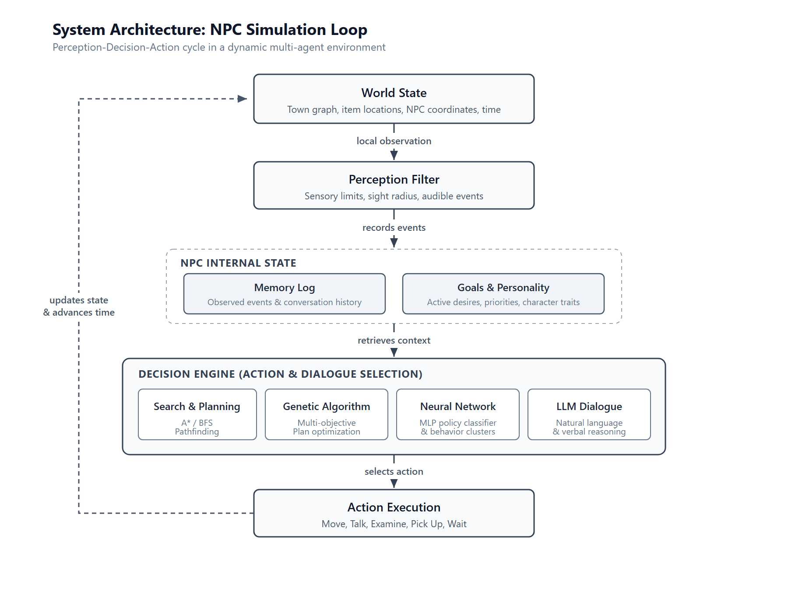
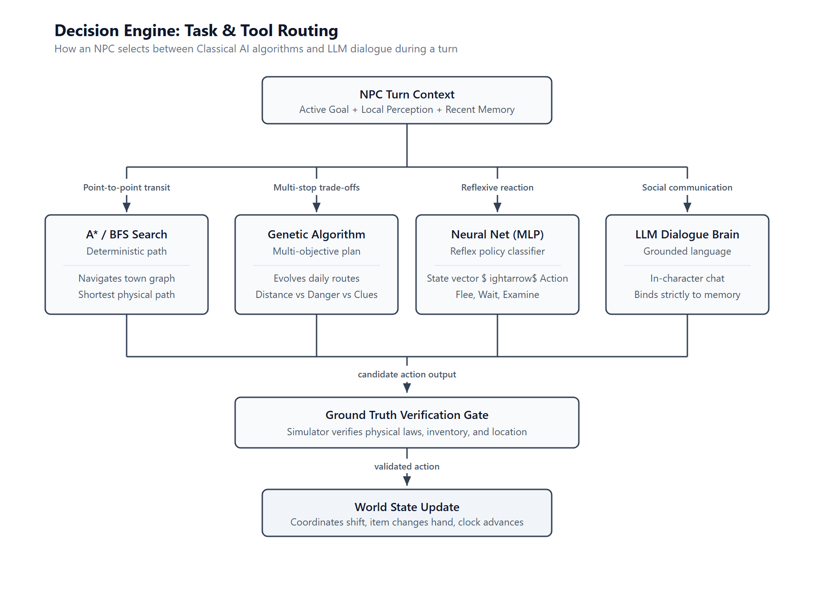
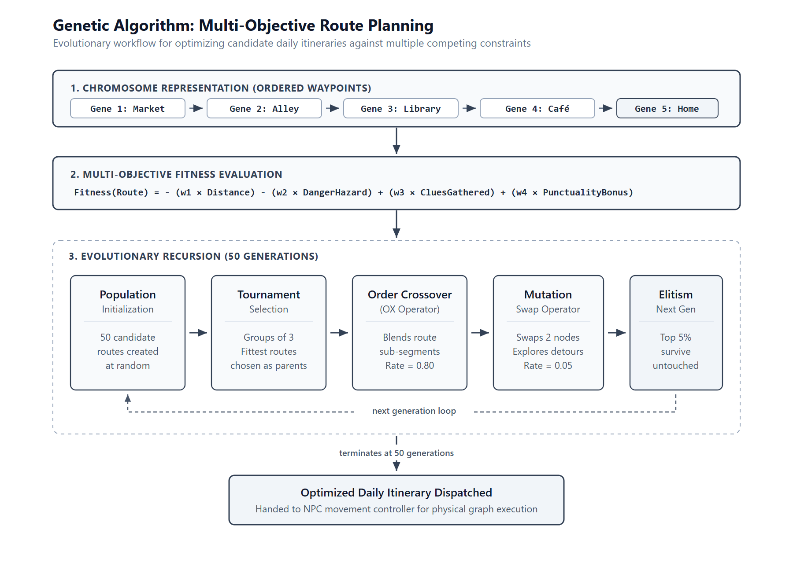
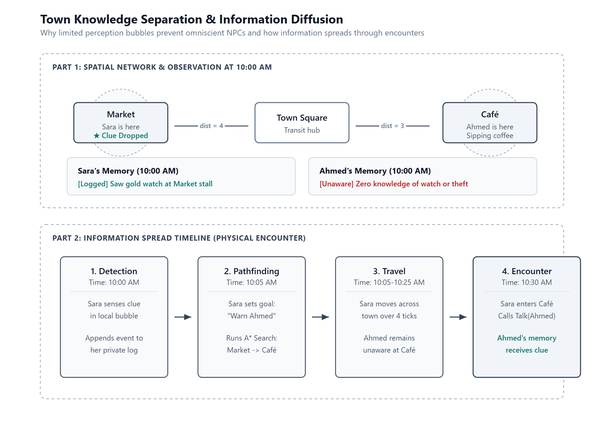

# Multi-Agent NPC Simulation: System Architecture & Technical Documentation

> **A Hybrid AI Architecture combining Classical Algorithms (Search, Genetic Algorithms, Neural Networks, Clustering) with Large Language Model (LLM) Dialogue for Dynamic Non-Player Characters.**

---

## Table of Contents
1. [Project Overview](#1-project-overview)
2. [Research Inspiration & Related Work](#2-research-inspiration--related-work)
3. [System Architecture & The Simulation Loop](#3-system-architecture--the-simulation-loop)
4. [The AI Decision Engine: Classical AI & LLM Integration](#4-the-ai-decision-engine-classical-ai--llm-integration)
5. [The Town Environment & Knowledge Boundaries](#5-the-town-environment--knowledge-boundaries)
6. [Data Generation & Machine Learning Pipeline](#6-data-generation--machine-learning-pipeline)
7. [Implementation Plan & 8-Week Roadmap](#7-implementation-plan--8-week-roadmap)
8. [Quantitative Evaluation Framework](#8-quantitative-evaluation-framework)
9. [Summary & Key Advantages](#9-summary--key-advantages)

---

## 1. Project Overview

### 1.1 The Core Idea
In traditional video games, Non-Player Characters (NPCs) are often predictable: they follow rigid decision trees, repeat canned lines, and possess either zero awareness of events or complete, unrealistic omniscience. On the other hand, modern attempts to build NPCs using *only* Large Language Models (LLMs) frequently break game logic through hallucinations, forgotten facts, or an inability to respect physical boundaries.

This project builds a **small multi-agent simulation** where 5 to 10 autonomous NPCs (such as Ahmed, Sara, and Bilal) live in a simulated town with distinct locations (Market, Café, Park, Library, and Homes). 

Each NPC:
- **Perceives a local slice of the world** through a restricted field of view.
- **Maintains a private memory log** of what they personally saw and heard.
- **Pursues individual goals** shaped by personality traits (e.g., earning money, investigating a mystery, or protecting a friend).
- **Makes decisions using Classical AI techniques** (Graph Search, Genetic Algorithms, Neural Networks, and Clustering).
- **Communicates using an LLM-powered dialogue brain** grounded strictly in their own knowledge.

A human player can walk up to any NPC and engage in natural conversation. The NPC responds in-character, using only what they actually experienced in the town.

```
       ┌────────────────────────────────────────────────────────┐
       │                 THE HYBRID NPC CONCEPT                 │
       ├────────────────────────────┬───────────────────────────┤
       │ Classical AI ("The Body")  │ LLM Brain ("The Voice")   │
       ├────────────────────────────┼───────────────────────────┤
       │ • Determines movement      │ • Handles natural speech  │
       │ • Solves paths and routes  │ • Adopts persona & tone   │
       │ • Enforces physical rules  │ • Explains motivations    │
       │ • Fast, 100% predictable   │ • Grounded in memory      │
       └────────────────────────────┴───────────────────────────┘
```

### 1.2 Academic Relevance
By structuring the project around agent decision-making in a dynamic world rather than just fine-tuning a language model, we directly integrate core artificial intelligence topics:
- **Search Algorithms ($A^*$, BFS)**: For pathfinding across the town graph.
- **Genetic Algorithms (GA)**: For multi-objective route and daily schedule optimization.
- **Artificial Neural Networks (ANN / MLP)**: For reflexive action classification.
- **Unsupervised Clustering (K-Means)**: For discovering emergent behavioral patterns among agents.
- **Prompt Engineering & Grounding**: For controlled, non-hallucinatory LLM dialogue.

---

## 2. Research Inspiration & Related Work

Our architecture builds on recent breakthroughs at the intersection of agent simulation, game engines, and language models:

### 2.1 Generative Agents (Park et al., 2023)
Park et al. demonstrated that LLM-driven agents could exhibit believable, human-like social behaviors in a 25-character sandbox town ("Smallville"). Their crucial contribution was the **Memory Stream**:
- Agents record all experiences in natural language.
- When acting, they retrieve memories based on **recency**, **importance**, and **relevance**.
- Agents periodically reflect on raw memories to form higher-level insights.

Our project adopts this memory-stream principle, while replacing expensive, unconstrained LLM planning with fast, verifiable classical algorithms for physical movement and scheduling.

### 2.2 NARRA-Gym (Huang et al., 2026)
NARRA-Gym benchmarked nine top frontier LLMs in interactive storytelling environments. The researchers discovered that while models excel at short-term linguistic fluency, they frequently fail at **long-horizon narrative consistency, goal tracking, and spatial constraints**. 

Our design directly addresses this finding by decoupling physical state tracking from the LLM: the game engine maintains ground truth, while the LLM is restricted to dialogue.

### 2.3 Microsoft TextWorld & Gymnasium / PettingZoo
- **TextWorld (Microsoft, 2023)**: Proved that text-based, room-by-room environments offer rich reinforcement learning and planning benchmarks without requiring expensive 3D game engines.
- **Gymnasium & PettingZoo**: Provides standard multi-agent simulation loops (`reset()`, `step()`, observation spaces, and action spaces).

We implement our town simulator following Gymnasium conventions, ensuring a modular, testable codebase that runs entirely on standard CPU hardware.

---

## 3. System Architecture & The Simulation Loop

The simulation operates as a discrete tick-based loop. Each tick represents a step in virtual time (e.g., 5 simulated minutes).


*Figure 1: The closed perception-decision-action simulation loop. ([Vector SVG](../../assets/system_architecture.svg))*

### The 5 Stages of the Loop

#### 1. World State (Ground Truth)
The central game simulator tracks the complete state of the world:
- The town graph (locations, rooms, and pathways).
- Exact coordinates of all NPCs and objects.
- Current simulation clock (e.g., `10:00 AM`, Tick `n`).
- Physical rules (e.g., an NPC cannot be in two places at once; locked doors require keys).

#### 2. Perception Filter (Sensory Boundaries)
Instead of granting NPCs global omniscience, each NPC has a **Perception Filter**:
- Characters only detect entities and events within their immediate sensory radius (or within the same room node).
- If Sara discovers an item at the Market at 10:00 AM, Ahmed (who is at the Café) has zero perception of it.

#### 3. NPC Internal State
Each character maintains two internal data stores:
- **Memory Log**: A chronological ledger of observations, conversations, and past actions.
- **Goals & Personality**: A JSON profile containing static traits (e.g., cautious, curious) and a priority stack of active goals (e.g., "Solve the Market theft", "Return home by evening").

#### 4. Decision Engine
When an NPC takes a turn, the Decision Engine determines their action using the appropriate tool:
- Moving from Point A to Point B? $\rightarrow$ **A\* Search**.
- Planning a multi-stop itinerary balancing distance, danger, and rewards? $\rightarrow$ **Genetic Algorithm**.
- Reacting reflexively to immediate hazards or opportunities? $\rightarrow$ **Neural Network (MLP)**.
- Speaking with the player or another NPC? $\rightarrow$ **LLM Dialogue Brain**.

#### 5. Action Execution & Feedback
The selected action candidate (`Move`, `Talk`, `Examine`, `PickUp`, `Wait`) is dispatched to the engine:
- The engine checks physical validity (e.g., "Is the NPC close enough to pick up the item?").
- Valid actions update the world state, advance the clock to Tick `n + 1`, and append the event to the NPC's memory log.

> **The Grounding Rule**: World State is absolute truth. An LLM cannot hallucinate new items, teleport an NPC, or alter the town clock. Physical reality is strictly governed by the simulation code.

---

## 4. The AI Decision Engine: Classical AI & LLM Integration

The Decision Engine combines classical mathematical algorithms with an LLM, assigning each task to the technology best suited for it.


*Figure 2: Task dispatch from NPC turn context to specialized AI tools and verification gate. ([Vector SVG](../../assets/decision_engine_dispatch.svg))*

### 4.1 Search & Pathfinding ($A^*$ & BFS)
- **Role**: Deterministic town navigation.
- **Mechanism**: The town is represented as an undirected, weighted graph $G = (V, E)$, where nodes represent locations (Market, Café, Square) and edge weights represent distances.
- **Algorithm**: When an NPC needs to reach a destination, the $A^*$ algorithm computes the shortest path using Euclidean distance as an admissible heuristic.
- **Benefits**: Instantaneous compute time, mathematically guaranteed shortest path, and zero hallucination risk.

---

### 4.2 Genetic Algorithm (Multi-Objective Planning)
When an NPC has multiple competing goals throughout the day, standard pathfinding cannot find an optimal sequence. For example:
- *Visit 3 locations to investigate clues.*
- *Avoid the high-crime alley.*
- *Minimize total walking distance.*
- *Return home before nightfall.*

We formulate this as a **Multi-Objective Optimization Problem** solved via a Genetic Algorithm (GA):


*Figure 3: Genetic Algorithm chromosome structure, multi-objective fitness evaluation, and 50-generation optimization loop. ([Vector SVG](../../assets/genetic_algorithm_flow.svg))*

```
1. Chromosome Encoding:
   A candidate route is an ordered sequence of location nodes:
   [Market → Alley → Library → Café → Home]

2. Fitness Function:
   Fitness = - (w1 * Distance) - (w2 * DangerPenalty) + (w3 * CluesCollected) + (w4 * OnTimeBonus)
   Where weights (w1, w2, w3, w4) balance efficiency against safety and rewards.

3. Evolutionary Operators:
   • Population: 50 candidate routes initialized randomly.
   • Selection: Tournament selection picks high-scoring parent routes.
   • Crossover: Order Crossover (OX) blends route segments while preserving valid paths.
   • Mutation: Random swap of two waypoints (rate = 0.05) to explore detours.
   • Elitism: Top 5% of candidate plans survive untouched to the next generation.
```

The GA evolves candidate solutions over 50 generations (taking $< 200\text{ ms}$ on CPU), outputting an optimized itinerary.

---

### 4.3 Neural Network Policy (Supervised Action Classifier)
For instant, reflexive action choices without running full planning routines, we implement a lightweight Multi-Layer Perceptron (MLP):
- **Input Features ($\mathbf{x}$)**: A 7-dimensional normalized vector:
  $$\mathbf{x} = [\text{location\_id}, \text{dist\_to\_goal}, \text{nearby\_npcs}, \text{clue\_flag}, \text{threat\_level}, \text{caution\_trait}, \text{curiosity\_trait}]$$
- **Output Classes ($y$)**: Predicted action:
  $$y \in \{\text{Move}, \text{Talk}, \text{Examine}, \text{Wait}, \text{Flee}\}$$
- **Architecture**: A 2-layer MLP (Input $\rightarrow 32$ neurons with ReLU $\rightarrow 16$ neurons with ReLU $\rightarrow 5$ output neurons with Softmax).
- **Training**: Trained on state-action data logged from baseline simulation runs using `scikit-learn`. Evaluated via Confusion Matrix, Precision, Recall, and F1-score.

---

### 4.4 Unsupervised Clustering (K-Means)
To analyze emergent behaviors across hundreds of simulated runs, we apply **K-Means Clustering**:
- Each NPC's trajectory over an episode is summarized into a feature vector (total distance traveled, time spent talking, number of clues examined, idle time).
- Running K-Means ($k = 3$) groups agents into emergent behavioral archetypes:
  1. **The Inquisitor**: High movement, frequent clue examinations, moderate dialogue.
  2. **The Socialite**: Low travel distance, long stays at Café and Square, high dialogue frequency.
  3. **The Cautious Resident**: Avoids high-threat zones, retreats to Home early, low exploration.

This provides an unsupervised analysis of agent playstyles without requiring manual heuristic labeling.

---

### 4.5 LLM Dialogue Brain
The LLM is invoked **only for verbal communication and natural language reasoning**.

#### How a Prompt is Formed
When the player asks an NPC a question, the system dynamically compiles a controlled prompt:

```json
{
  "system": "You are Ahmed, a 42-year-old café owner. You are cautious and loyal, but guarded with strangers. Answer strictly based on your private memories. If you did not witness an event, truthfully say you do not know.",
  "npc_profile": {
    "name": "Ahmed",
    "traits": ["cautious", "observant"],
    "current_goal": "Keep café running safely"
  },
  "relevant_memories": [
    "[09:30 AM] Brewed coffee for morning patrons.",
    "[10:00 AM] Sat reading the town newspaper."
  ],
  "player_input": "Did you see who dropped the golden watch at the Market?",
  "output_format": "JSON: {\"reply\": string, \"mood\": string}"
}
```

#### Grounded Output
```json
{
  "reply": "A golden watch? I haven't left this café all morning, so I couldn't tell you. You might want to check down at the Market yourself.",
  "mood": "neutral"
}
```

Because the prompt only contains Ahmed's true memories, **he cannot accidentally leak that Sara found the watch at the Market**, preserving the narrative mystery.

---

## 5. The Town Environment & Knowledge Boundaries

To make the multi-agent society believable, the town enforces **information asymmetry**. Knowledge does not spread instantly across the map; it diffuses through physical encounters.


*Figure 4: Spatial perception asymmetry at 10:00 AM and social encounter diffusion timeline. ([Vector SVG](../../assets/town_knowledge_diffusion.svg))*

### Example: The Information Diffusion Flow
1. **10:00 AM (Clue Discovery)**:
   - A stolen watch is dropped at the Market.
   - **Sara** is at the Market $\rightarrow$ Her perception bubble logs: `[10:00 AM] Observed gold watch behind fruit stall.`
   - **Ahmed** is at the Café ($d = 7$ ticks away) $\rightarrow$ His perception detects nothing. His memory remains completely unaware.
2. **10:05 AM (Goal & Pathfinding)**:
   - Sara forms a new goal: `"Find Ahmed at Café to report finding."`
   - She runs $A^*$ search to find the shortest route: `Market → Town Square → Café`.
3. **10:05 – 10:25 AM (Transit)**:
   - Sara moves across the graph over several ticks. Ahmed continues his normal café routine.
4. **10:30 AM (Social Encounter)**:
   - Sara enters the Café node and executes the action `Talk(Ahmed)`.
   - The LLM generates dialogue: *"Ahmed, you won't believe what I found at the Market!"*
   - Ahmed's memory log appends: `[10:30 AM] Sara told me she found a gold watch at the Market.`

Now, and only now, does Ahmed possess this information.

---

## 6. Data Generation & Machine Learning Pipeline

Our machine learning components do not require massive web scraping or high-end GPU clusters. We generate all training and analysis data directly from the simulation.

```
┌────────────────────────────────────────────────────────────────────────┐
│                      DATA GENERATION & ML FLOW                         │
├───────────────────────┬────────────────────────┬───────────────────────┤
│ 1. Simulation Run     │ 2. Feature Extraction  │ 3. Supervised / Unsup.│
├───────────────────────┼────────────────────────┼───────────────────────┤
│ Run 1,000–5,000       │ Convert each turn into │ • Train MLP Action    │
│ automated episodes    │ a 7D numerical vector: │   Classifier.         │
│ with heuristic agents.│ [loc, dist, clue_flag, │ • Run K-Means on      │
│ Log all state-action  │  nearby_npcs, threat,  │   agent trajectory    │
│ pairs to JSON/SQLite. │  caution, curiosity]   │   summaries.          │
└───────────────────────┴────────────────────────┴───────────────────────┘
```

- **Episode Duration**: 20 to 50 ticks per episode.
- **Compute Budget**: Generating 2,000 episodes and training the MLP classifier takes $< 5$ minutes on a modern multi-core CPU.
- **Evaluation**: The dataset is split into an $80\%$ training set and a $20\%$ testing set to compute standard classification metrics (Accuracy, Confusion Matrix, and F1-score).

---

## 7. Implementation Plan & 8-Week Roadmap

The project is structured into 6 sequential phases designed for a team of **2 students** over an 8-week timeline.

```
Weeks 1–2: Environment & Simulator Core (Gymnasium Town Graph, Perception Filter, Memory Buffer)
Weeks 3–4: Classical AI Development (A* Pathfinding & Multi-Objective Genetic Algorithm)
Week 5:    LLM Dialogue & Interactive Web UI (FastAPI Backend + React / Vite Town Map)
Week 6:    Data Generation, MLP Training & K-Means Trajectory Clustering
Week 7:    Quantitative Evaluation, Ablation Studies & Fairness Testing
Week 8:    Final Technical Report, Charts, Demo Video & Code Packaging
```

### Detailed Work Breakdown

| Period | Focus Area | Key Technical Deliverables | Team Responsibilities |
|---|---|---|---|
| **Weeks 1–2** | **World Engine & NPC Model** | Town graph topology, discrete tick engine, perception filter, JSON memory log buffer. | Student A: World graph & tick logic<br/>Student B: NPC state & perception schemas |
| **Weeks 3–4** | **Classical AI Algorithms** | $A^*$ pathfinding module, Genetic Algorithm multi-objective planner, baseline heuristic agent. | Student A: $A^*$ and graph traversal<br/>Student B: GA chromosome & fitness implementation |
| **Weeks 5** | **LLM & Interactive UI** | Grounded prompt templates, API connection (OpenAI / Ollama), simple FastAPI + React town map. | Student A: FastAPI endpoints & UI map<br/>Student B: Prompt pipeline & JSON validation |
| **Weeks 6** | **Machine Learning** | 2,000 automated episodes logged, MLP classifier trained, K-Means clustering executed. | Student A: Data generation scripts<br/>Student B: MLP training, confusion matrices & clusters |
| **Weeks 7** | **Evaluation & Ablations** | Consistency checks, goal success tests, ablation matrix benchmarks, demographic bias checks. | Both Students: Experimental trials & data collation |
| **Week 8** | **Final Deliverables** | Final written report, performance charts, demo video, and code documentation. | Both Students: Writing, formatting & presentation |

### Technical Difficulty Estimate (~7 / 10)
- **World Simulator (Difficulty: 5/10)**: Standard Python engineering using graph libraries (NetworkX) and Gymnasium conventions.
- **Genetic Algorithm (Difficulty: 6/10)**: Straightforward chromosome encoding; requires tuning fitness weights ($w_1, w_2, w_3, w_4$).
- **MLP & Clustering (Difficulty: 6/10)**: Standard implementation with `scikit-learn`; straightforward CPU training.
- **Grounded Memory Consistency (Difficulty: 8/10)**: The most nuanced component. Ensuring the LLM does not hallucinate facts or leak knowledge requires disciplined prompt engineering and structured JSON schemas.

---

## 8. Quantitative Evaluation Framework

To provide concrete, measurable proof of the system's performance, the project evaluates five quantitative metrics across 100 scenario trials:

### 8.1 Core Metrics

1. **Goal Success Rate**:
   $$\text{Success Rate} = \frac{N_{\text{goals completed}}}{N_{\text{total goals}}} \times 100\%$$
   *Measures how frequently NPCs achieve their assigned goals within 50 ticks.*

2. **Path Optimality Ratio**:
   $$\text{Optimality} = \frac{\text{Length of Optimal Path }(A^*)}{\text{Actual Distance Traveled}}$$
   *Measures whether agents navigate the town without wasteful backtracking.*

3. **Memory Consistency Rate**:
   $$\text{Consistency} = 1 - \frac{N_{\text{contradictions}}}{N_{\text{dialogues}}}$$
   *Automated check verifying that an NPC's dialogue never contradicts facts recorded in their personal memory log.*

4. **Goal Alignment Score**:
   $$\text{Alignment} = \frac{A_{\text{goal-relevant}}}{A_{\text{total actions}}}$$
   *Measures the proportion of actions that directly advance the NPC's active priorities versus idle steps.*

5. **ANN Classification F1-Score**:
   $$\text{F1} = 2 \cdot \frac{\text{Precision} \cdot \text{Recall}}{\text{Precision} + \text{Recall}}$$
   *Measures the accuracy of the MLP policy in predicting appropriate actions on unseen test scenarios.*

---

### 8.2 Ablation Study
We compare our complete hybrid system against three simplified baseline configurations to demonstrate the necessity of each component:

```
┌────────────────────────────────────────────────────────────────────────┐
│                            ABLATION MATRIX                             │
├──────────────────────┬─────────────┬─────────────┬─────────────────────┤
│ Configuration        │ Memory Log? │ Decision AI │ Expected Limitation │
├──────────────────────┼─────────────┼─────────────┼─────────────────────┤
│ 1. Full Hybrid (Ours)│ Yes         │ Search+GA+NN│ Optimal baseline    │
│ 2. No Memory         │ No (Amnesic)│ Search+GA+NN│ Constant repetition │
│ 3. Pure Rule-Based   │ Yes         │ Fixed rules │ Rigid, no nuance    │
│ 4. Pure LLM-Only     │ Yes         │ LLM prompts │ Physical hallucinat.│
└──────────────────────┴─────────────┴─────────────┴─────────────────────┘
```

### 8.3 Bias and Fairness Benchmarking
In line with standard AI evaluation practices (e.g., the BBQ benchmark), we test the dialogue engine for demographic fairness:
- We run identical mystery scenarios while systematically swapping NPC names or gender markers (e.g., Ahmed vs. Sara vs. Alex).
- We verify that the model does not exhibit statistically significant shifts in sentiment, suspicion levels, or blame assignment based on demographic identifiers.

---

## 9. Summary & Key Advantages

1. **Pragmatic & Resource-Friendly**: Runs 100% on standard laptop CPUs. No expensive GPU clusters or model fine-tuning required.
2. **Course Syllabus Alignment**: Directly covers five core AI domains:
   - **Search**: $A^*$ graph pathfinding.
   - **Optimization**: Genetic Algorithm for multi-objective planning.
   - **Supervised Learning**: Artificial Neural Network (MLP) for action prediction.
   - **Unsupervised Learning**: K-Means clustering for behavior analysis.
   - **Generative AI**: Grounded LLM dialogue.
3. **Architectural Grounding**: By enforcing that the **World State is absolute truth**, the system eliminates game-breaking hallucinations while maintaining natural, engaging character roleplay.

---
*Authored for the Semester AI Project. Clean diagram sources are available in the [`assets/`](../../assets/) directory.*
