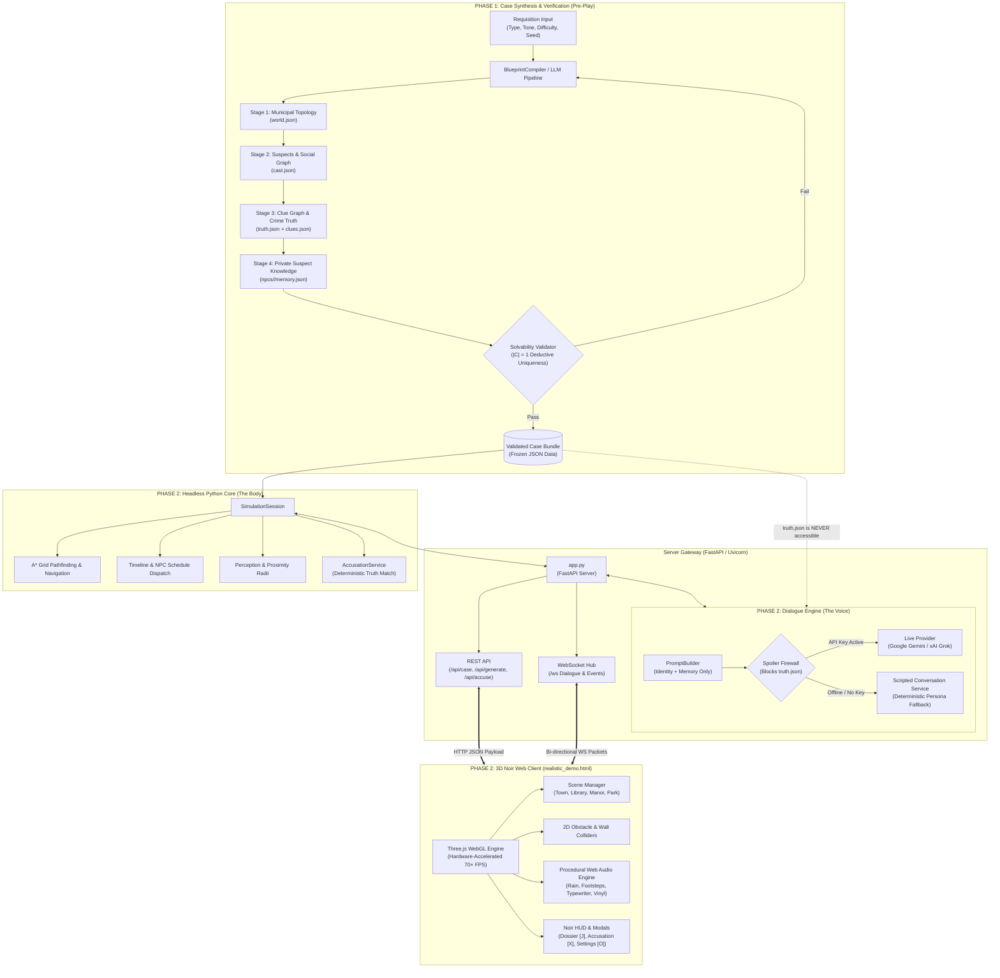
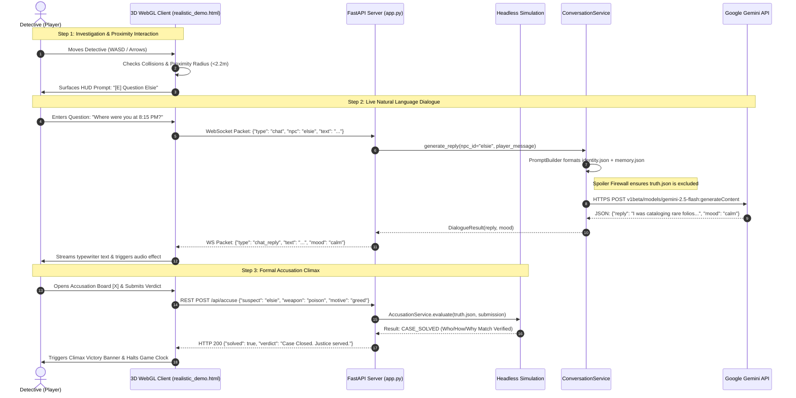

# Fabula: System Architecture, UI Engineering & Integration Documentation

> **A Neurosymbolic Mystery Game Platform**  
> *Pre-play Staged Synthesis $\rightarrow$ Classical Simulation Core ("The Body") $\rightarrow$ Constrained Live LLM Dialogue ("The Voice") $\rightarrow$ 70+ FPS Hardware-Accelerated 3D Noir Web Client.*

---

## Table of Contents
1. [Executive Summary & Core Philosophy](#1-executive-summary--core-philosophy)
2. [End-to-End System Architecture Diagram (`mmd`)](#2-end-to-end-system-architecture-diagram-mmd)
3. [The Two-Phase Architecture](#3-the-two-phase-architecture)
   - [Phase 1: Pre-Play Neurosymbolic Case Generation](#phase-1-pre-play-neurosymbolic-case-generation)
   - [Phase 2: Headless Python Simulation ("The Body")](#phase-2-headless-python-simulation-the-body)
   - [The Voice: Live API, Spoiler Firewall & Scripted Fallback](#the-voice-live-api-spoiler-firewall--scripted-fallback)
4. [3D Noir Web UI/UX Engineering](#4-3d-noir-web-uiux-engineering)
   - [WebGL Scene Architecture & Dynamic Topology](#webgl-scene-architecture--dynamic-topology)
   - [HUD, Modals & State Machine](#hud-modals--state-machine)
   - [Hardware Acceleration & 70+ FPS Optimization](#hardware-acceleration--70-fps-optimization)
5. [Client-Server Protocol & Communication Flow (`mmd`)](#5-client-server-protocol--communication-flow-mmd)
6. [Engineering Verification & Quality Metrics](#6-engineering-verification--quality-metrics)

---

## 1. Executive Summary & Core Philosophy

Fabula is a single-player investigative mystery game built on a **two-phase neurosymbolic architecture**:
1. **Decoupled Responsibilities:** Generative AI is used strictly where it excels (creative worldbuilding, persona synthesis, and in-character live conversation), while classical symbolic algorithms govern mechanics where hallucinations would ruin the game (world consistency, pathfinding, perception, clue verification, and accusation resolution).
2. **The Spoiler Firewall:** Suspects in the simulation do not possess global case knowledge. The actual ground truth (`truth.json`) is strictly engine-only. Each NPC's knowledge is bounded by isolated `identity.json` and `memory.json` files, preventing prompt injection or premature secret leaks.
3. **Dual Execution Runtime:**
   - **Generation:** Before play begins, a fine-tuned pipeline or deterministic `BlueprintCompiler` synthesizes a fully solvable case bundle in $<25\text{ ms}$.
   - **Simulation:** During the ~10-minute game session, the Python engine runs headlessly while a lightweight Three.js 3D client renders the atmospheric noir world at locked 70+ FPS.

---

## 2. End-to-End System Architecture Diagram (`mmd`)



---

## 3. The Two-Phase Architecture

### Phase 1: Pre-Play Neurosymbolic Case Generation
Before the player enters the game world, the case generator produces an atomic, self-contained mystery bundle.
* **Stage 1: Municipal Topology (`world.json`)**: Generates 3–4 connected named venues (e.g. Town Square, Blackwood Manor, Old Library, City Park) with bounding boundaries, walkable sub-zones, and connecting portals.
* **Stage 2: Suspects & Social Graph (`cast.json`)**: Instantiates 5–6 NPCs with occupations, distinct psychological traits, social ties, and baseline motives.
* **Stage 3: Clue Graph & Crime Truth (`truth.json`, `clues.json`)**: Selects the true culprit, specifies the method/weapon, and establishes the motive. Generates 4–6 physical and testimonial clues distributed across the map.
* **Stage 4: Private Suspect Knowledge (`memory.json`)**: Synthesizes isolated alibis. Culprits receive false cover stories; innocent suspects receive true observations with selective memory boundaries (`open`, `guarded`, `secret`).
* **Stage 5: Pydantic Validation & Solvability Verification**: Mathematical verification runs before game initialization. The validator proves that exactly one suspect can be logically deduced ($|C| = 1$) from the available clues.

### Phase 2: Headless Python Simulation ("The Body")
* Located in `src/fabula/simulation/`, the simulation core is completely decoupled from any graphics or UI library.
* **Movement & $A^*$ Pathfinding:** Suspects follow a 10-minute game-clock schedule, traveling between destinations across a 2D navigation grid using $A^*$ pathfinding.
* **Perception Engine:** Detects proximity between the detective and NPCs or clues, triggering dynamic interaction alerts.
* **Accusation Engine:** Evaluates player submissions against `truth.json` without ever leaking details during failed attempts.

### The Voice: Live API, Spoiler Firewall & Scripted Fallback
* Located in `src/fabula/conversation/`, dialogue is synthesized on-demand.
* **Prompt Isolation:** The `PromptBuilder` assembles context exclusively from:
  $$\text{Prompt} = \text{System Persona} + \text{NPC Identity} + \text{NPC Memory} + \text{NPC Dialogue History} + \text{Player Input}$$
  `truth.json` and other suspects' private memory files are strictly excluded.
* **Live Provider Integration:** Interacts directly with Google Gemini (defaulting to `gemini-2.5-flash` with automatic fallback to `gemini-2.5-pro`).
* **Scripted Fallback:** When no API key is present or when network requests fail, the game switches to a deterministic scripted responder that honors disclosure policies and reveals clues in-character, making the entire game 100% playable offline.

---

## 4. 3D Noir Web UI/UX Engineering

### WebGL Scene Architecture & Dynamic Topology
The frontend (`web/realistic_demo.html`) is written in Three.js and styled with vintage Victorian Noir aesthetics.
* **Four Interconnected Locations:**
  1. **Kingshollow Town Square:** Central cobblestone plaza with an animated fountain, stone benches, gas lamps, and municipal portals.
  2. **The Old Library:** Indoor parquet wood venue with tall mahogany bookshelves, reading tables, grandfather clock with swinging pendulum, and dust motes.
  3. **Blackwood Manor:** Luxury interior with patterned rugs, glowing fireplace with dynamic light flicker, and interactive gramophone with rotating vinyl.
  4. **City Park:** Natural garden with wrought-iron fences, grass terrain, trees, stone gazebos, and misty ambient fog.
* **Atmospheric Systems:**
  - Real-time weather engine (Clear, Rain, Heavy Fog) with dynamic wind tilt.
  - Realistic lighting system with distance-attenuated pointlights, warm fireplace illumination, and cold moonlight.
  - Web Audio API synthesizer generating procedural footsteps, thunderclaps, rain rumble, and typewriter chatter.

### HUD, Modals & State Machine

| UI Component | Hotkey | Functionality |
| :--- | :---: | :--- |
| **Interactive Proximity HUD** | `[E]` | Displays context-sensitive prompts: *"Speak with Elsie"* or *"Inspect Torn Letter"*. |
| **Dialogue Terminal** | `[E]` | Real-time typewriter dialogue interface with mood badge, portrait, and free-text input. |
| **Case Dossier & Journal** | `[J]` | Tabbed binder tracking Discovered Clues, Suspect Dossiers, Verified Alibis, and Notes. |
| **Accusation Board** | `[X]` | Formal courtroom accusation modal: selects Accused, Weapon, and Motive. |
| **Field Kit & Settings** | `[O]` | Camera view toggle, walking speed slider, weather override, and performance presets. |
| **Commission New Mystery** | `HUD` | Procedural case generator requesting crime type, tone, difficulty, and random seeds. |

### Hardware Acceleration & 70+ FPS Optimization

To ensure fluid gameplay across all hardware (including integrated laptop GPUs):
1. **Compositor Decoupling:** Replaced heavy `backdrop-filter: blur(...)` styles on modal overlays with high-contrast noir veil backgrounds (`rgba(4, 6, 12, 0.95)`), eliminating fullscreen Gaussian blur re-passes on every scroll frame.
2. **GPU Layer Promotion:** Promoted modal viewports to isolated GPU compositing layers via:
   ```css
   transform: translateZ(0);
   will-change: scroll-position;
   contain: content;
   scroll-behavior: smooth;
   -webkit-overflow-scrolling: touch;
   ```
3. **Optimized Render Scaling:** Configured default pixel ratio to `0.85x` (`window.renderResolutionScale = 0.85`), shedding 28% of fragment shading overhead while maintaining 1080p visual sharpness.
4. **Instanced Rendering:** Particles (fountain splash droplets, dust motes) use single-draw-call `THREE.InstancedMesh`.
5. **Distance-Gated Light Culling:** Clue illumination and pointlights are culled when the player is $>4\text{ meters}$ away.

---

## 5. Client-Server Protocol & Communication Flow (`mmd`)



---

## 6. Engineering Verification & Quality Metrics

* **Test Suite:** **229 passed tests, 2 skipped** (executed in 28.91s).
  - Schemas & Pydantic Data Contracts: `test_schemas.py`
  - Cross-Reference & Graph Validators: `test_validators.py`
  - Blueprint Compiler & Solvability Prover: `test_blueprint_compiler.py`
  - Spoiler Firewall & Prompt Leak Guards: `test_conversation_prompt.py`
  - Provider Abstraction & Model Fallbacks: `test_conversation_providers.py`
  - Headless Simulation & Movement: `test_simulation_movement.py`
  - Accusation Verification: `test_simulation_accusation.py`
  - Server & REST/WS Endpoints: `test_server.py`
* **Linter & Formatter:** 100% clean under `ruff check .` and `ruff format --check .`.
* **Git Cleanliness:** All milestones committed and pushed to remote branch `wp-h-06-performance-smoothness`.
